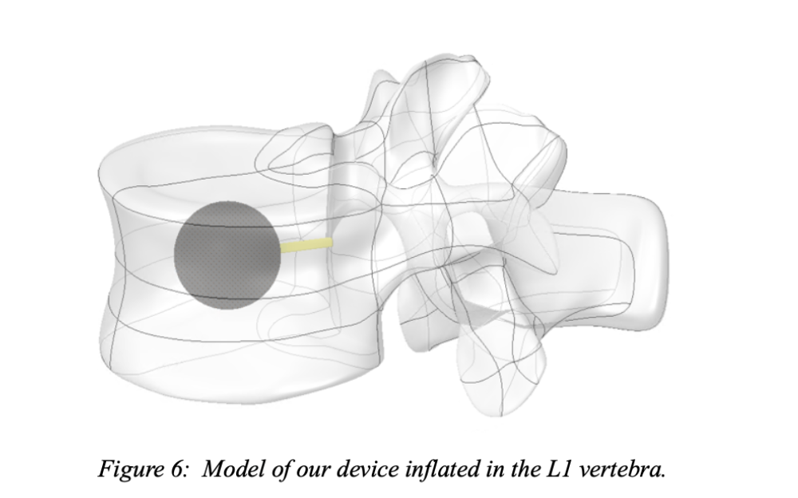
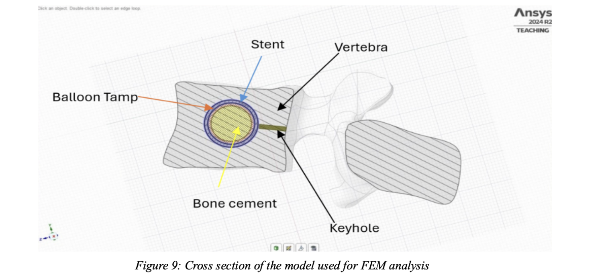
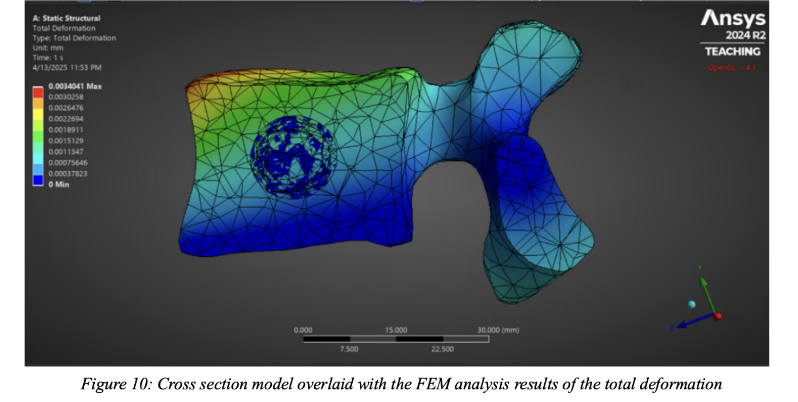

# Spinal Implant Design for Metastatic Spinal Cord Compression

Our design brief was a 40-year-old woman with late-stage breast cancer that had spread to her spine, causing pain, reduced sensation and impaired mobility. We designed a new balloon kyphoplasty device to stabilise her spine more safely.

**Group coursework (team of six) plus an individual literature review · Biomedical Device Development · Queen Mary University of London, 2024–25**

## What we did

Balloon kyphoplasty restores the height of a collapsed vertebra by inflating a balloon inside it and filling the space with bone cement. The standard procedure carries risks, including cement leaking out of the bone and blood clots. As a team, we worked through the clinical need, developed and scored several concepts against design criteria, and settled on a device with:

- a biodegradable balloon made from PLGA copolymer or PLA
- aerosolised spray delivery of the bone cement, for more control
- a hydrogel coating on the balloon
- a stainless-steel stent to hold the vertebra in place

We considered materials, manufacturing, patient comfort, risks, and regulatory and ethical requirements, and tested the design with a finite element model of the device inside the L1 vertebra.

## My individual work

Alongside the group design, I wrote a critical review of current fracture fixation: fixation methods, biomaterials, bone grafts, and the problems that still cause implants to fail, such as non-union, stress shielding and infection. It gave the clinical and engineering background for the design work.

## Results

- Under compressive loading, the FEM model showed a maximum total deformation of about **0.0034 mm**, suggesting the device would keep the vertebra stable.
- The report sets out what would still need to be done before the design could go further, including more detailed testing and validation.

## Files

- [Group design report](./spinal-implant-design-report.pdf) (team members' names removed for privacy)
- [My fracture fixation literature review](./fracture-fixation-literature-review.pdf)
